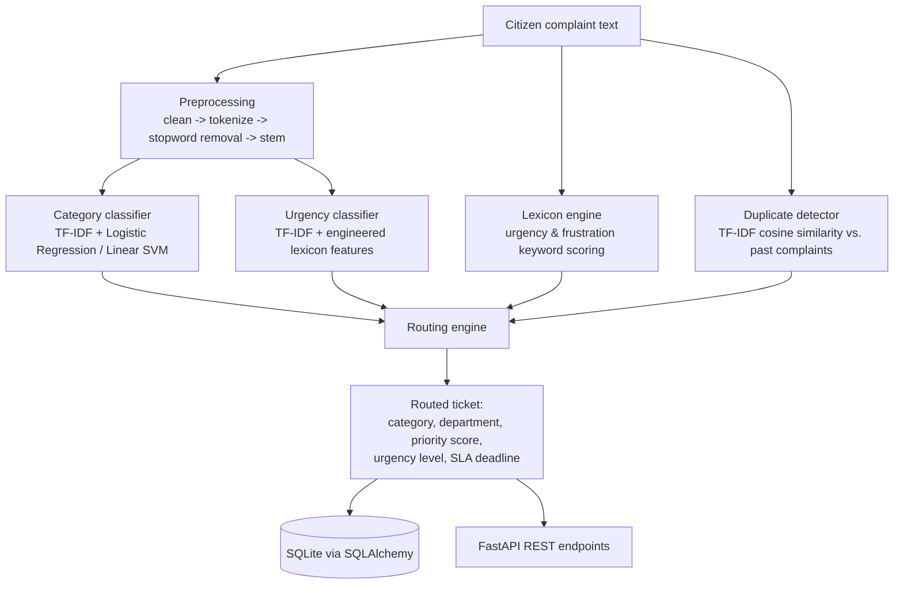

# CivicLens AI

**An NLP system that understands, prioritizes, and routes citizen complaints automatically.**

Built as an NLP capstone project. A citizen submits a free-text complaint ("There's a huge pothole on MG Road, a bike already crashed into it!") and CivicLens classifies *what* the issue is about, judges *how urgent* it is, checks whether *other citizens have already reported it*, and routes it to the *correct civic department* with a service-level deadline — all from the raw text, with no manual tagging.

## Contents

- [Why this exists](#why-this-exists)
- [How it works](#how-it-works)
- [Results](#results)
- [Project structure](#project-structure)
- [Getting started](#getting-started)
- [API reference](#api-reference)
- [Design decisions worth knowing about](#design-decisions-worth-knowing-about)
- [Limitations & future work](#limitations--future-work)

## Why this exists

Municipal grievance systems (potholes, water outages, sanitation, safety) typically rely on citizens picking a category from a dropdown and a human clerk deciding what's urgent. In practice, citizens pick the wrong category, urgent issues sit in a queue behind trivial ones, and the same pothole gets reported five times as five separate, uncorrelated tickets. CivicLens AI addresses all three problems with NLP:

1. **Understands** — classifies the complaint into a civic category and extracts urgency/sentiment signal from the text itself.
2. **Prioritizes** — blends a trained classifier with a transparent rule-based lexicon and a repeat-complaint boost into one auditable priority score.
3. **Routes** — maps the result onto a responsible department and a concrete SLA deadline.

## How it works



**Pipeline stages** (see [`civiclens/pipeline.py`](civiclens/pipeline.py) for the orchestration):

| Stage | Module | Technique |
|---|---|---|
| Preprocessing | `civiclens/nlp/preprocessing.py` | Regex tokenization, scikit-learn's English stopword list, NLTK `PorterStemmer` |
| Category classification | `civiclens/nlp/category_model.py` | TF-IDF (1–2 grams) + best of Multinomial Naive Bayes / Logistic Regression / Linear SVM, chosen by 5-fold cross-validation |
| Urgency classification | `civiclens/nlp/urgency_model.py` | TF-IDF **+** 11 hand-engineered lexicon/stylistic features, combined via `FeatureUnion`, feeding the best of Logistic Regression / Linear SVM / Random Forest |
| Rule-based scoring | `civiclens/nlp/lexicons.py` | A transparent, hand-authored keyword lexicon for urgency and frustration/sentiment — every score is traceable to the words that produced it |
| Duplicate detection | `civiclens/nlp/duplicates.py` | TF-IDF cosine similarity against previously submitted complaints in the same category |
| Routing | `civiclens/routing/router.py` | Deterministic category→department and urgency→SLA tables, blended with the duplicate-report boost into a final 0–100 priority score |
| Serving | `api/main.py` | FastAPI + SQLAlchemy/SQLite REST API |

Every ticket carries an `explanation` field listing exactly which keywords, model confidences, and duplicate reports produced its priority score — the system is designed to be auditable by a human reviewer, not a black box.

## Results

Full metrics (cross-validation table, confusion matrices, per-class precision/recall) are generated by `civiclens/evaluate.py` into [`reports/evaluation_report.md`](reports/evaluation_report.md). Headline numbers on a held-out 20% test split (600 complaints, never seen during training):

| Model | Test accuracy | Notes |
|---|---|---|
| Category classifier | **98.3%** | 10 classes; confusions only between genuinely related categories (e.g. Roads ↔ Street Lighting) |
| Urgency classifier | **94.5%** | 4 ordinal classes; ordinal mean absolute error **0.055** — every test prediction was exact or off by at most one urgency level, none were wildly wrong |

The dataset is synthetic (see [Design decisions](#design-decisions-worth-knowing-about)), with **simulated label noise and typos deliberately injected** so these numbers reflect a realistically imperfect problem rather than a trivial template-matching exercise.

## Project structure

```
CivicLens-AI/
├── civiclens/
│   ├── config.py              # categories, department routing table, SLA policy
│   ├── data/generate_dataset.py   # synthetic dataset generator
│   ├── nlp/
│   │   ├── preprocessing.py   # cleaning, tokenizing, stemming
│   │   ├── lexicons.py        # rule-based urgency/sentiment scoring
│   │   ├── features.py        # engineered numeric features for the urgency model
│   │   ├── category_model.py  # category classifier (train/predict/save/load)
│   │   ├── urgency_model.py   # urgency classifier (train/predict/save/load)
│   │   └── duplicates.py      # TF-IDF similarity duplicate detector
│   ├── routing/router.py      # combines model outputs into a routed Ticket
│   ├── pipeline.py            # ComplaintAnalyzer: the single end-to-end entry point
│   ├── train.py                # trains + saves all models
│   ├── evaluate.py             # generates reports/evaluation_report.md
│   └── db/                     # SQLAlchemy models + session setup
├── api/main.py                 # FastAPI app (REST endpoints)
├── scripts/demo_cli.py         # command-line demo, no API/DB required
├── data/raw/complaints_dataset.csv   # generated synthetic dataset (3000 rows)
├── models/*.joblib              # trained, ready-to-use model artifacts
├── reports/evaluation_report.md # generated evaluation metrics
└── tests/                       # pytest suite (preprocessing, lexicons, routing, pipeline, API)
```

## Getting started

Trained models, the generated dataset, and the evaluation report are already committed, so you can go straight to the demo or the API. Retraining steps are included for completeness.

```bash
git clone <this-repo-url>
cd CivicLens-AI
python3 -m venv .venv && source .venv/bin/activate
pip install -r requirements.txt
```

**Try it instantly on the command line:**

```bash
python scripts/demo_cli.py --samples
python scripts/demo_cli.py "There is a huge pothole on MG Road, a bike already crashed into it, please fix immediately!"
python scripts/demo_cli.py --interactive
```

**Run the API:**

```bash
uvicorn api.main:app --reload
# Swagger UI: http://127.0.0.1:8000/docs
```

**Run the tests:**

```bash
pytest tests/ -v
```

**(Optional) Regenerate the dataset and retrain from scratch:**

```bash
python -m civiclens.data.generate_dataset   # rewrites data/raw/complaints_dataset.csv
python -m civiclens.train                   # retrains + saves all models to models/
python -m civiclens.evaluate                # regenerates reports/evaluation_report.md
```

## API reference

| Method | Path | Description |
|---|---|---|
| `GET` | `/health` | Health check; reports whether trained models are loaded |
| `POST` | `/complaints` | Submit a complaint (`{"text": "...", "location": "..."}`) → returns the full routed ticket |
| `GET` | `/complaints` | List complaints, filterable by `category`, `urgency`, `department`, `status`; paginated |
| `GET` | `/complaints/{complaint_id}` | Fetch a single complaint |
| `PATCH` | `/complaints/{complaint_id}/status` | Update status to `Open` / `In Progress` / `Resolved` |
| `GET` | `/stats/dashboard` | Aggregate counts by category/urgency/department, for a triage dashboard |

Example:

```bash
curl -X POST http://127.0.0.1:8000/complaints \
  -H "Content-Type: application/json" \
  -d '{"text": "No water supply in our area for three days, elderly residents are struggling.", "location": "Ward 2 - Old Town"}'
```

## Design decisions worth knowing about

- **Why a synthetic dataset?** No real municipal 311-style dataset was available to redistribute for this project. `civiclens/data/generate_dataset.py` builds one from hand-written templates that are themselves tiered by urgency (a "Critical" template uses real emergency language; a "Low" template uses the soft language of a minor suggestion), so labels reflect genuine textual signal rather than arbitrary metadata — the same process a human annotator would follow reading real complaints. To keep evaluation honest, the generator also injects **simulated label noise** (~8% of urgency labels and ~3% of category labels are perturbed to a plausible neighbor, modeling real annotator disagreement) and **typos/word-merges** (~50% of complaints get at least one), which is why accuracy lands at a believable ~94–98% instead of a suspicious 100%.
- **Why blend an ML classifier with a rule-based lexicon instead of trusting the classifier alone?** ([`civiclens/routing/router.py`](civiclens/routing/router.py)) A misclassified "Low" on a genuinely dangerous complaint is a much worse failure mode for a civic safety system than a percentage point of accuracy. The final priority score is `0.7 × classifier confidence-weighted score + 0.3 × transparent lexicon score`, plus a boost when several similar complaints already exist — no single model can unilaterally under-prioritize a dangerous report.
- **Why no downloaded NLTK corpora (punkt/stopwords/wordnet)?** To keep the pipeline runnable fully offline after `pip install`. Stopwords come from scikit-learn's bundled list; stemming uses NLTK's `PorterStemmer`, which is a pure algorithm with no data file; tokenization is a small regex. No accuracy was sacrificed for this — see Results.
- **Why treat urgency as 4-class classification instead of ordinal regression?** Simplicity, given the timeline. `evaluate.py` reports an ordinal mean-absolute-error specifically to catch the failure mode plain accuracy would hide (confusing *adjacent* levels vs. wildly wrong ones).

## Limitations & future work

- **Validate on real complaints.** The synthetic dataset is designed to be realistic but is not a substitute for real, messy citizen-submitted text (code-mixed language, extreme brevity, sarcasm). The architecture is dataset-agnostic — swapping in a real corpus means regenerating `data/raw/complaints_dataset.csv` with the same schema and re-running `civiclens.train`.
- **Multilingual support.** Real citizens often write in regional languages or code-mixed text; the current TF-IDF pipeline is English-only.
- **Transformer fine-tuning.** A fine-tuned DistilBERT/IndicBERT could likely push category accuracy further on messier real text; skipped here to keep the pipeline lightweight and fully explainable, which matters for a civic-facing system.
- **Ordinal urgency model.** A proper ordinal regression (or an ordinal loss on top of the same features) would be a more principled fit than plain multiclass classification.
- **Frontend dashboard.** The API is ready to back a triage dashboard for civic staff; none is included here so this project stays focused on the NLP pipeline itself.
- **Active learning.** Feed staff corrections (re-categorizations, urgency overrides) back into periodic retraining.
